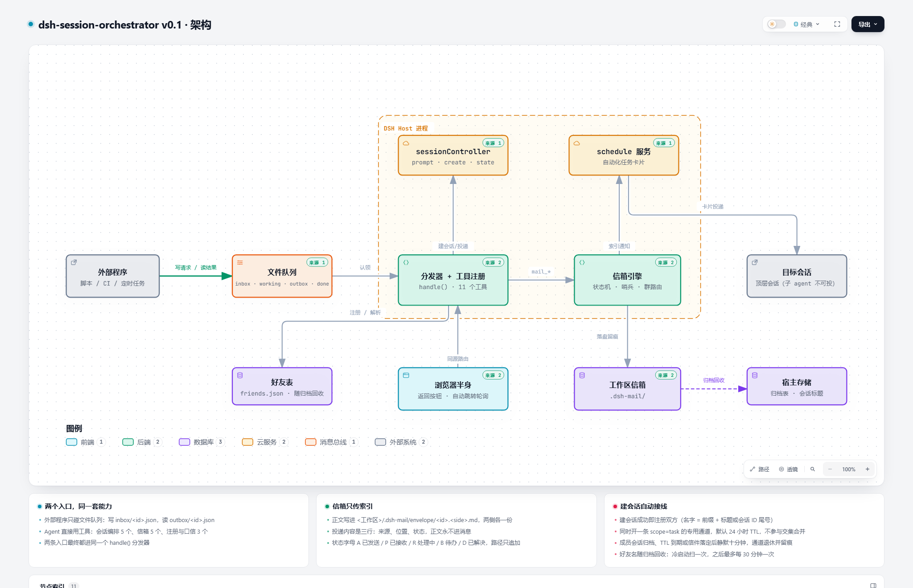

# dsh-session-bridge

 

Let the sessions inside DeepSeek Harness create each other, jump to each other, and write letters to each other.

[中文](./README.md) · [Architecture](https://7nian173.github.io/dsh-session-orchestrator/architecture.html) · Version v0.1

## What this software does

Once installed, your sessions gain three abilities.

**Start a new session.** Create a workspace and its first session from a preset, handing over the directory, the opening task, and the title in one call. No manual window opening, no directory switching, no preset picking.

**Jump to another session.** When an assistant reply mentions a session id, an "Open session" button appears under that message. One click switches to it. In the session you land in, a "Back to creator" button shows up in the bottom left corner, right next to the sandbox permission switch. One click returns you to the session that created it. Both buttons are one-shot, so they never linger after a refresh.

**Write a letter.** Send a letter to another session. The body is written into a file inside the workspace, and the receiver gets only an index entry naming the source, the path, and the current state. Whether to read the body is up to it. A letter with no receipt turns into a to-do when the window expires, moves to in-progress on a receipt, and is archived on close. After a few round trips between the same pair of sessions, a group forms automatically and later letters between them route through it.

Creating a session wires those three things together. Both sides register into the friends table, each workspace gets its mailbox, and a dedicated channel opens between the two of you, valid for 24 hours by default.

## Quick start

After installing, three steps are enough for a first run.

```
# 1. Register a name for yourself. Registration also creates the workspace mailbox
session_register_name  name=lead

# 2. Write to another session. peerSessionId is that session's id
mail_send  owner=lead  peer=reviewer  type=S-PROGRESS  body="please review this build"  peerSessionId=session-xxxx

# 3. Check where the letter got to
mail_status  mailId=M-20261017-0001
```

The third call returns `fromPath` and `toPath`, for example `A>R>D` and `P>R>D`, which records the path the letter took on the sending and the receiving side.

External programs do not use these tools. They drop files into the queue, as described under "Two entry points" below.

## Environment dependencies

The plugin has no process of its own. It runs inside the Host process, so at runtime it depends on the Host. The table separates runtime from install time; do not read them as one list.

| Dependency | Runtime | Install time | Notes |
|---|---|---|---|
| DeepSeek Harness **0.2.2-rc.3** | required | required | The Host. The version was read from the official instance running on this machine and forms the compatibility baseline |
| Host services `sessionController`, `sessionPersistence`, `schedule`, `webServer` | required | n/a | Provided by the Host; the plugin treats them as optional and degrades per feature |
| Host events `agent/pre-step`, `agent/status` | required | n/a | Missing either one breaks receipts and the sentinel |
| `@deepseek-ai/schemastery` `~3.19.0` | required | required | The only runtime dependency, downloaded from npm at install time |
| A reachable npm registry | no | required | Needed to fetch that dependency; prepare it first in an offline environment |
| pnpm 11 | no | required | DSH ships one, used by both `plugin_manager` and `dsh plugin`, so usually nothing to install |
| Node >= 18 | no | for the self-check scripts | The plugin uses the Host's built-in Node (the official desktop app bundles 24.21.0); the scripts under `tools/` and the CLI need one of your own |
| Git | no | when installing from a repository URL | Not needed for a local directory install |

Three hard requirements besides the table.

- Use an absolute path to the plugin directory. The path may contain non-ASCII characters.
- Write access to the queue directory (default `$DSH_HOME/session-bridge`) and to the workspace directories. The queue carries cross-session delivery (`session-bridge/`), the workspace stores letters (`.dsh-mail/`).
- The desktop profile is managed exclusively by Electron, so plugins there install only through `plugin_manager`, never `dsh plugin`.

## Install

### For an AI to run

Install once:

```
plugin_manager action=install_bundle target=<absolute path to the plugin directory>
```

After editing any `.js`, a reload is mandatory. The two commands cannot be reversed:

```
plugin_manager action=remove_bundle target=dsh-session-orchestrator
plugin_manager action=install_bundle target=<absolute path to the plugin directory>
```

The only proof of success is `application` equal to `applied` in the receipt. Logs and process presence do not count.

### Command line (non-desktop profiles)

DSH ships one command that forwards its arguments to pnpm, installing the package together with its dependencies:

```
dsh plugin --profile <profile> add github:<account>/dsh-session-orchestrator
```

No extra packaging is needed. Verified on the `headless` profile: when it finishes, `dependencies` and `dsh.profile.bundles` in that profile's `package.json` each gain one entry, the three files under `lib/` are in place, and `@deepseek-ai/schemastery` resolves from npm.

It does not work for the desktop profile, which Electron manages exclusively and where `dsh plugin` fails outright. Desktop users install through `plugin_manager` above.

### For a human

1. Put the plugin directory somewhere it will not be moved. Moving it breaks the `link:` entry in the profile and forces a reinstall.
2. Install that directory from the DSH plugin panel, or let the assistant run the two commands above. You should see a row named `session-bridge` at version `0.1.0`.
3. Do not just flip the switch after changing code. `set_bundle enabled=false → true` does not reload modules. The interface looks unchanged while the old copy keeps running. Always uninstall and reinstall.
4. A client-side change needs one full page refresh. One refresh is enough; no application restart.
5. To confirm the install, send a letter and check that `push.via` in the receipt is `schedule` and that `mailBox` points at a real workspace path.

## Configuration

| Field | Default | Purpose |
|---|---|---|
| `dir` | `''` (meaning `$DSH_HOME/session-bridge`) | Queue root directory, with its six subdirectories |
| `pollMs` | `1000` | Queue scan interval |
| `replyTimeoutMs` | `180000` | Default wait for one turn of reply |
| `maxReplyChars` | `8000` | Reply truncation length |
| `deliverMode` | `queue` | `queue` or `steer` |
| `maxConcurrent` | `4` | Requests handled at once |
| `parseAttempts` | `3` | Retries when a request file is half written |
| `parseRetryDelayMs` | `400` | Delay between retries |
| `autoJump` | `true` | Allow queued interface navigation |
| `allowCrossWorkspace` | `false` | Let friends reach across workspaces |
| `ackTimeoutMs` | `300000` | Without a receipt in this window, the letter becomes a to-do |
| `notifyToken` | `''` | Shared token for `/session-bridge/notify`, empty means no check |
| `backTtlMs` | `1800000` | How long a jump keeps offering the back button |
| `childNamePrefix` | `agent-` | Name prefix used when a new session registers automatically |
| `taskChannelTtlMs` | `86400000` | Lifetime of the dedicated channel between creator and child |
| `taskChannelIdleMs` | `600000` | Idle time before a channel whose letters all settled is retired |
| `courierIntervalMs` | `5000` | Gap between two courier notice deliveries |
| `busyHoldMs` | `180000` | Time a target may stay busy before an undelivered letter is held |
| `staleAfterMs` | `1800000` | Time an envelope may sit untouched before one extra nudge |
| `digestGapMs` | `600000` | Minimum gap between two sender digests while the count is unchanged |

## Two entry points

External programs and agents use the same capabilities through different doors.

### The file queue, for external programs

No login state, no listening port. Drop JSON into one directory, read the result from another.

```
<root>/inbox/<id>.json        receive (inbox)     request, write .tmp then rename
<root>/working/<id>.<x>.json  in flight (working) claimed and running
<root>/outbox/<id>.json       collect (outbox)    result, always written, atomic
<root>/done/<id>.json         done (done)         also the idempotency ledger
<root>/failed/<id>.json       failed (failed)     failure copy
<root>/heartbeat.json         heartbeat           liveness timestamp
```

Available actions are `deliver`, `sessions`, `events`, `init_workspace`, `handoff`, `notify`, `relay`, `list_children`, `jump`, `delete_workspace`, and `probe_workspace_stream`; mailbox actions are `mail_send`, `mail_ack`, `mail_list`, `mail_status`, `mail_pause`, and `mail_group`. One id is never processed twice, so retrying with the same id returns the first result.

### Model tools, for agents

Eleven in total.

| Tool | Purpose |
|---|---|
| `session_init_workspace` | Create a workspace and start its first session |
| `session_handoff` | Hand off to a new session under a different preset |
| `session_jump` | Queue a one-shot interface navigation |
| `session_register_name` | Register a name in the current workspace, creating its mailbox |
| `session_list_names` | List registered names |
| `session_tell` | Send a short direct message to a registered name |
| `mail_send` | Write a letter |
| `mail_ack` | Acknowledge a letter; `close` settles it |
| `mail_list` | List letters by owner |
| `mail_status` | Path taken, owning group, overdue flag, channel backlog for one letter |
| `mail_pause` | Pause or resume the courier channel, or report its backlog |
| `mail_group` | Create or list groups, or fetch workspace candidates |

## How a letter travels

The mailbox lives inside the workspace, one set per workspace.

```
<workspace>/.dsh-mail/            mailbox directory (.dsh-mail/)
    _letters.json                 letter state: every letter in this workspace
    envelope/<mail_id>.<side>.md  letter bodies: one per side, side is from or to
    _index.json                   path index: the letter sequence for each side
    _ledger.json                  event trail: append-only, never rewritten
    group.json                    group table: members and dedicated channels
    _courier.json                 courier channel: queued items, pause flag, digest dedupe
```

State, directory, and letter map to each other in a fixed way.

| Letter | State | Meaning |
|---|---|---|
| `A` | 已发送 (sent) | Left the sender, waiting for a receipt |
| `P` | 已接收 (received) | Arrived at the other side, untouched |
| `R` | 处理中 (in progress) | The other side started working on it |
| `B` | 待办 (to-do) | Could not be delivered, or nobody answered in time |
| `D` | 已解决 (done) | Settled |

Paths only append. The sender typically walks `A>R>D` and the receiver `P>R>D`; a stall in the middle shows up as a branch such as `A>B`.

Delivery itself carries three lines of index, and the body stays in the envelope file. Only after the other side reads it and sends a receipt does the index move from received to in progress.

### To-do, courier, and backpressure

Past `ackTimeoutMs` without a receipt a letter turns `B` (to-do). Instead of firing a card at both sides, it is handed to the courier channel.

The channel is `<workspace>/.dsh-mail/_courier.json`, one per workspace, strictly serial: one notice at a time, then a `courierIntervalMs` pause (5 seconds by default) before the next. It resumes from the file after a restart.

Three rules.

| Rule | Value | Why |
|---|---|---|
| In flight per session | at most 1 unconsumed card | the target runs one turn at a time; extra cards only take up queue space |
| Open letters per pair | at most 1 | no receipt, no new letter; `S-ACK` and `S-TODO-NOTICE` are exempt |
| Nudges per letter | at most 2 | one initial, one from the stale watchdog |

Reminders come in two forms, and the two sides see different cards.

```
(receiver) 〔信箱·待收〕M-20261117-0031
(sender)   〔信使〕你名下现在 5 封待办：lead 3 封、peer 2 封，最早 41 分钟前。
           不是对方不理你，是信没被消费或没拿到回执，别等。
```

If the target stays busy, the letter waits in the held queue (`held`) and the envelope header records `paused: true`. When the target goes idle, the channel first reports the count ("you have N unprocessed"), then delivers one at a time, gated by the previous card being consumed. Only when an envelope sits past `staleAfterMs` (30 minutes by default) may one extra nudge go out.

To stop everything, use `mail_pause` (`do: pause | resume | status`). The flag is on disk and survives restarts.

More than the threshold of round trips between the same pair (three by default) forms a group automatically, and two groups that share a member merge into one. The dedicated channel opened when a session is created is a different thing: it carries `scope=task`, never joins a merge, and retires when a member is archived, when its TTL expires, or when every letter in it settled and stayed idle for ten minutes. Retirement removes the group record and leaves one trail entry.

## Maintenance and self-checks

Run these from the repository root. They need Node and nothing else, no dependency install.

```
node tools/mail-push-test.mjs            # push, channel, backpressure, groups, workspace mailbox, 48 checks
node tools/mail-index-repair.mjs <cwd>   # rebuild _index.json from _ledger.json, run with --dry-run first
```

Repairing the index also syncs the `path:` line inside each envelope. The script only adds, never deletes, so repeated runs converge on the same result.

## Troubleshooting

Find the line that matches what you see and do what it says.

### A letter will not go out

**The receipt says `NO_MAILBOX`.** No session in the target workspace has registered yet, so no mailbox exists there. Have the other side run `session_register_name` once, or use `/拉群` to register it automatically.

**The receipt says `UNRESOLVED`.** The name you gave is neither a registered name nor a workspace session title. The response carries a candidate list for this workspace; pick one and send again.

**The receipt says `PAIR_OUTSTANDING`.** The previous letter between the same pair is still open; the receipt carries its id and status. Wait for its receipt, or check the backlog with `mail_pause`. `S-ACK` and `S-TODO-NOTICE` are exempt.

**The receipt says `SENDER_NOT_REGISTERED`.** You passed `senderSessionId` but that identity was never registered. Register first, or drop the field. This restriction is deliberate.

**The receipt says `owned by subagent routing`.** The target is a sub-agent session, and the Host refuses pushes to it. Use its parent session, or ask the parent to forward.

**The receipt has `queued` false with reason `no-controller`.** The Host service is not ready yet. Wait for the plugin to finish remounting and try once more rather than retrying in a loop.

**The receipt says `TARGET_ARCHIVED`.** The other side has been archived and the Host will not deliver there any more. Pick a live session, or unarchive it in the interface first.

### The letter left but nothing happened

**No card appears in the other session.** Check `toPath` in `mail_status` first. If it contains `P`, the letter is on disk but never reached the other context. Then check `push.via` in the sending receipt: `prompt` means the `schedule` service was unavailable and delivery fell back.

**It stays at `P` forever.** That is expected until the other side reads it. Past `ackTimeoutMs` without a receipt it becomes `B` and the letter moves to the courier channel.

**It turned `B` and the other side still says nothing.** Check `queue` in the `mail_status` reply: `held` means the target stayed busy so nothing was delivered; `paused` means somebody paused the channel. `mail_pause` with `do: status` reports the backlog and how old its oldest item is.

**The sender never got a receipt and assumes the peer is ignoring it.** Look for the `〔信使〕` digest card: it aggregates per sender and is not resent while the numbers stay the same.

**The other side says it received nothing.** Have it look in its own letter body directory (`.dsh-mail/envelope/`). If the file is there, the letter landed and simply never entered its context.

### The button is missing, or never goes away

**"Open session" never appears.** The message body has no `sa-session:<id>` marker, or that marker was already used once. A used marker never comes back, even after a refresh.

**"Back to creator" never appears.** This visit was not caused by a real jump. Manually switching sessions in the left column does not count; only a button click or an automatic jump does.

**The button reappears after a refresh.** The browser half is still the old copy. Do one full page refresh.

**The button never disappears.** It expires by itself after `backTtlMs`, and clicking it consumes it immediately.

### Installed, but nothing changed

**Code changed, behaviour did not.** You only flipped the `set_bundle` switch, so modules were not reloaded. Run `remove_bundle` and then `install_bundle`.

**No `session-bridge` row in the plugin list.** The install used a relative path. Use the absolute path to the plugin directory.

**The Host reports `HMR transactions cannot be nested` on startup.** A previous reload did not finish unwinding. Wait a moment before remounting, or restart the application once.

### External programs cannot reach it

**The request returns 403 with `Browser access is disabled`.** Desktop rejects HTTP requests from anything other than the renderer, so `/session-bridge/*` routes only serve the browser. External programs must use the file queue.

**Requests dropped into the queue do nothing.** Check whether `time` in `<root>/heartbeat.json` is still advancing. If it is not, the plugin is not running; confirm its row in the plugin list is enabled.

### One extra injection every time

**`[SCHEDULE CHANGE]` shows up in the context.** The Host adds it on every delivery, about 97 tokens measured. The plugin cannot suppress it; it is a fixed cost of using the `schedule` channel.

## Project layout

```
Host half (lib/index.js)         queue, tool registration, same-origin routes, friends table, session orchestration
Mailbox engine (lib/mail.js)     state machine, letter storage, index, trail, groups and dedicated channels
Browser half (lib/client.js)     jump button and back button
Mount entry (cordis.patch.yml)   row id is session-bridge
Architecture (docs/)             diagram and generation receipts
Self-checks (tools/)             two node scripts, run in place
```

## Architecture and workflow



[Click for the full workflow](https://7nian173.github.io/dsh-session-orchestrator/architecture.html)

The diagram supports light and dark themes, zoom, and full screen. What follows walks the lines once.

External programs write requests into the queue receive directory (`inbox/`), and the dispatcher claims them and routes by action. Agents call tools and land on the same dispatcher without touching files.

Creating a session goes through `sessionController.create`. On success the plugin writes a jump record, the browser half polls it and switches the page, and the credential for "Back to creator" is stored at the same time.

Writing a letter goes through the mailbox engine. The engine lands both envelopes in their own workspaces, updates the path index and the trail, then hands a three-line index to the `schedule` service for delivery. Once the target reads it and acknowledges, the index moves from received to in progress, and to done on close.

## What it costs you

To deliver some of its features, the plugin performs the following cross-workspace actions.

### 1 It creates directories and files in the target workspace root

- A mailbox directory (`.dsh-mail/`) is created, holding state, index, trail, and both letter bodies.
- Workspaces the plugin creates always register the mailbox directory. Workspaces you set up by hand and older workspaces are untouched; the directory appears only when the cross-session protocol is actually used.

### 2 Cross-session traffic goes through the mailbox

- One delivery produces one notice worth of noise. That is a fixed behaviour of the Host (DSH), about 96 tokens. The actual conversation content is attached inside the letter, and every state change of a letter is rewritten by the plugin.
- You may edit the body, but please leave the header alone.

A real envelope looks like this.

```
---
mail_id: M-20261117-0009
type: S-PROGRESS
from: lead
to: std-verify
timestamp: 2026-11-17T06:13:54.281Z
status: 处理中
side: to
dir_owner: session-8ce66a91-91ee-46f8-9b8d-991e012035d0
path: P>R
---
v0.1.0 live test: the body lives only in the envelope file, MARKER-OCTRL-001.
```


## Version

v0.1.0, first release, 2026-11-17.

## License

[CC BY-NC 4.0](./LICENSE), Creative Commons Attribution-NonCommercial 4.0 International.

What that means in plain terms.

**You may change it.** You may keep your changes closed, or ship only binaries. Your derivative work can use any license you like, as long as it does not stop downstream recipients from complying with this one.

**You must credit it.** When you distribute, keep the author information and the copyright notice, note what you changed, and include a link to the license. Please also keep the original repository address.

**You may not sell it.** Commercial means use primarily intended for commercial advantage or monetary compensation. Personal study, research, internal trials, and non-profit team work are unrestricted.

Two caveats. Creative Commons licenses are written for works rather than for software, so using one here is workable but not standard. A license with a NonCommercial clause is not an OSI-approved open source license, so describe this repository as source-available rather than open source.

For commercial licensing, contact the author. If you would rather use a license designed for software with the same commercial restriction, PolyForm Noncommercial 1.0.0 is the closest fit, though it carries no attribution requirement by default and would need an added credit clause.