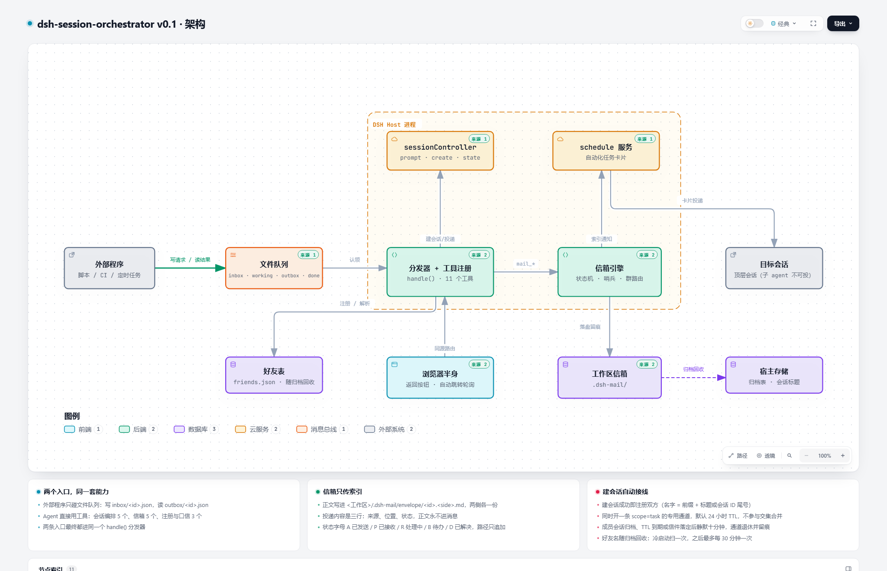

# dsh-session-bridge

 

让 DeepSeek Harness 里的多个会话可以互相创建、互相跳转、互相写信。

[English](./README.en.md) · [架构图](https://7nian173.github.io/dsh-session-orchestrator/architecture.html) · 当前版本 v0.1

## 这个软件能做什么

装上之后，你的会话多出三种能力。

**开新会话**。按预设建一个工作区和它的一期会话，目录、初始任务、标题一起交出去。不用手动开窗口、切目录、挑预设。

**跳到别的会话**。助手回复里出现某个会话的编号时，正文下方会有一个「打开会话」按钮，点一下就切过去。被切过去的那个会话，左下角沙盒权限切换的旁边出现「返回创建者」，点一下回到把它建出来的会话。两个按钮都是一次性的，刷新之后不会一直挂着。

**写信**。给另一个会话发一封信。正文写进工作区的文件里，对方收到的只是一条索引，写明来源、位置和当前状态。要不要读正文由它自己决定。没回执的信在超时后转成待办，收到回执就进处理中，关闭之后归档。同一对人来回几封之后会自动结成一个群，之后这一对人的信都按群路由走。

开新会话的时候，上面三件事自动接上。双方互相注册进好友表，各自的工作区里建好信箱，再开一条只给他们两人用的专用通道，默认 24 小时有效期内随时能来回通信。

## 快速开始

装好之后第一次用，走这三步就够。

```
# 1. 给自己登记一个名字，注册的同时会建好工作区信箱
session_register_name  name=lead

# 2. 给另一个会话写信。peerSessionId 是对方的会话编号
mail_send  owner=lead  peer=reviewer  type=S-PROGRESS  body="这一版看下"  peerSessionId=session-xxxx

# 3. 看这封信走到哪了
mail_status  mailId=M-20261017-0001
```

第三步的返回里会带 `fromPath` 与 `toPath`，比如 `A>R>D` 和 `P>R>D`，这就是这封信在发信方和收信方各自走过的路。

外部程序不用这些工具，直接往队列里投文件即可，写法见下面的「两条入口」。

## 环境依赖

插件本体没有自己的进程，它跑在宿主进程里，所以运行时只依赖宿主。下面这张表分开列了「运行时」和「装的时候」两件事，别混着看。

| 依赖 | 运行时 | 安装时 | 说明 |
|---|---|---|---|
| DeepSeek Harness **0.2.2-rc.3** | 必须 | 必须 | 宿主。版本号取自本机正在运行的官方实例，是当前的适配基线 |
| 宿主服务 `sessionController`、`sessionPersistence`、`schedule`、`webServer` | 必须 | 不适用 | 由宿主提供，插件只做可选依赖，缺了对应功能降级 |
| 宿主事件 `agent/pre-step`、`agent/status` | 必须 | 不适用 | 缺一个，回执与哨兵就不工作 |
| `@deepseek-ai/schemastery` `~3.19.0` | 必须 | 必须 | 唯一的运行时依赖，装的时候从 npm 下载 |
| 可访问的 npm registry | 否 | 必须 | 下载上面那个依赖用；离线环境要先把它备好 |
| pnpm 11 | 否 | 必须 | DSH 自带一份，`plugin_manager` 和 `dsh plugin` 都调它，通常不用单独装 |
| Node ≥ 18 | 否 | 跑自检脚本时 | 插件用宿主内置的 Node（官方桌面端自带 24.21.0）；`tools/` 下的脚本和 CLI 需要自己有一个 |
| Git | 否 | 从仓库地址安装时 | 用本地目录安装不需要 |

另外三条硬要求。

- 插件目录要用绝对路径，路径里可以有中文。
- 队列目录（默认 `$DSH_HOME/session-bridge`）和工作区目录都要能写。队列负责跨会话投递（`session-bridge/`），工作区负责存信（`.dsh-mail/`）。
- 桌面版的 profile 由 Electron 独占管理，装插件只能走 `plugin_manager`，不能用 `dsh plugin`。

## 安装

### 给 AI 执行

装一次：

```
plugin_manager action=install_bundle target=<插件目录绝对路径>
```

改过 `.js` 之后必须重载，两条命令顺序不能反：

```
plugin_manager action=remove_bundle target=dsh-session-orchestrator
plugin_manager action=install_bundle target=<插件目录绝对路径>
```

判定成功的依据是回执里的 `application` 为 `applied`，不是日志，也不是进程还在不在。

### 命令行安装（非桌面环境）

DSH 自带一条命令，参数转发给 pnpm，包和它的依赖一起装上：

```
dsh plugin --profile <环境名> add github:<账户>/dsh-session-orchestrator
```

不需要另做包装。实测在 `headless` profile 上跑通：装完 `package.json` 的 `dependencies` 和 `dsh.profile.bundles` 会自动各加一条，`lib/` 三个文件到位，`@deepseek-ai/schemastery` 从 npm 正常解析。

桌面版走不了这条。profile `desktop` 由 Electron 独占管理，`dsh plugin` 会直接报错，桌面版只能用上面的 `plugin_manager`。

### 给人操作

1. 把整个插件目录放在一个不会被移动的位置。目录一挪，profile 里的 `link:` 就断了，需要重新装一次。
2. 在 DSH 的插件面板里装这个目录，或者让助手跑上面那两条命令。装完会看到一行 `session-bridge`，版本 `0.1.0`。
3. 改动代码之后不要只切开关。`set_bundle enabled=false → true` 不会重新加载模块，界面上看起来没变化，实际还是旧的那份。必须走卸载加重装。
4. 浏览器半身改了之后要整页刷新。刷新一次即可，不用重启应用。
5. 想确认装好了，随便发一封信，看回执里 `push.via` 是不是 `schedule`，`mailBox` 是不是真实的工作区路径。

## 配置

| 字段 | 默认值 | 作用 |
|---|---|---|
| `dir` | `''`（即 `$DSH_HOME/session-bridge`） | 队列根目录，六个子目录都在它下面 |
| `pollMs` | `1000` | 队列扫描间隔 |
| `replyTimeoutMs` | `180000` | 等一轮回复的默认时长 |
| `maxReplyChars` | `8000` | 回复截断长度 |
| `deliverMode` | `queue` | `queue` 或 `steer` |
| `maxConcurrent` | `4` | 同时处理的请求数 |
| `parseAttempts` | `3` | 文件写一半时的重试次数 |
| `parseRetryDelayMs` | `400` | 每次重试的间隔 |
| `autoJump` | `true` | 允许排队的界面跳转 |
| `allowCrossWorkspace` | `false` | 允许好友跨工作区 |
| `ackTimeoutMs` | `300000` | 超过这段时间没有回执，信转待办 |
| `notifyToken` | `''` | `/session-bridge/notify` 的共享令牌，留空表示不校验 |
| `backTtlMs` | `1800000` | 一次跳转后，返回按钮保留多久 |
| `childNamePrefix` | `agent-` | 建会话自动注册时的名字前缀 |
| `taskChannelTtlMs` | `86400000` | 创建者与新会话之间专用通道的存活时长 |
| `taskChannelIdleMs` | `600000` | 群内信件全部落定后静默多久回收该通道 |
| `courierIntervalMs` | `5000` | 信使通道两条提醒之间的间隔 |
| `busyHoldMs` | `180000` | 目标一直在任务中超过这么久，信转待办 |
| `staleAfterMs` | `1800000` | 信封静置超过这么久，允许补一次催收 |
| `digestGapMs` | `600000` | 发信方摘要数字没变时的最小重发间隔 |

## 两条入口

外部程序和 Agent 走的是同一套能力，入口不同。

### 文件队列，给外部程序

不需要登录态，也不需要端口。往一个目录里投 JSON，读另一个目录拿结果。

```
<root>/inbox/<id>.json        收件（inbox）          请求，先写 .tmp 再 rename
<root>/working/<id>.<x>.json  处理中（working）      已认领，正在跑
<root>/outbox/<id>.json       取件（outbox）         结果，一定写，原子写
<root>/done/<id>.json         已完成（done）         同时是幂等账本
<root>/failed/<id>.json       失败（failed）         失败副本
<root>/heartbeat.json         心跳（heartbeat）      存活时间戳
```

可用 action 有 `deliver`、`sessions`、`events`、`init_workspace`、`handoff`、`notify`、`relay`、`list_children`、`jump`、`delete_workspace`、`probe_workspace_stream`，信箱相关的有 `mail_send`、`mail_ack`、`mail_list`、`mail_status`、`mail_pause`、`mail_group`。同一个 id 不会处理两次，用相同 id 重试拿到的是第一次的结果。

### 模型工具，给 Agent

共 12 个。

| 工具 | 用途 |
|---|---|
| `session_init_workspace` | 建工作区并起一期会话 |
| `session_handoff` | 按新预设交棒出一个新会话 |
| `session_jump` | 排队一次界面跳转 |
| `session_register_name` | 在当前工作区登记名字，顺带建信箱 |
| `session_list_names` | 列出已登记的名字 |
| `session_tell` | 给登记过的名字发一条即时口信 |
| `mail_send` | 写信 |
| `mail_ack` | 回执，带 close 表示结案 |
| `mail_list` | 按 owner 列出信件 |
| `mail_status` | 看某一封走过的路径、所属群、是否逾期、通道积压 |
| `mail_pause` | 暂停或恢复信使通道，查通道积压 |
| `mail_group` | 建群、列群，或取本工作区候选会话 |

## 信件怎么流转

信箱落在工作区里，一个工作区一套。

```
<工作区>/.dsh-mail/              信箱目录（.dsh-mail/）
    _letters.json                信件状态：这个工作区的全部信件
    envelope/<mail_id>.<side>.md 信件本体：两侧各一份，side 是 from 或 to
    _index.json                  路径索引：每封信每一侧的字母序列
    _ledger.json                 事件留痕：只追加，不修改
    group.json                   群路由表：群成员与专用通道
    _courier.json                信使通道：排队条目、暂停开关、摘要去重
```

状态、目录、字母三者对应关系固定：

| 字母 | 状态 | 含义 |
|---|---|---|
| `A` | 已发送 | 已经出手，等回执 |
| `P` | 已接收 | 到了对端，对方还没动 |
| `R` | 处理中 | 对方已经开始处理 |
| `B` | 待办 | 投不出去，或者超时没人回 |
| `D` | 已解决 | 结案 |

路径只追加不回退。发信方通常走 `A>R>D`，收信方走 `P>R>D`；中途卡住会看到 `A>B` 这样的分支。

投递本身只送三行索引，正文留在信封文件里。对方读过并回执之后，索引才从已接收变处理中。

### 待办、信使与背压

一封信超过 `ackTimeoutMs` 还没拿到回执就转 `B` 待办。这时不再向两侧各撒一张卡，而是交给信使通道。

通道是 `<工作区>/.dsh-mail/_courier.json`，全局一条，一条一条投，投完等 `courierIntervalMs`（默认 5 秒）再取下一条；重启后从文件接着投。

三条规矩。

| 规矩 | 值 | 为什么 |
|---|---|---|
| 同一会话在途 | 最多 1 张未消费的卡 | 目标一次只跑一轮，多塞的卡只是占位 |
| 同一对未结案 | 最多 1 封 | 上一封没回执就不许再发；`S-ACK`、`S-TODO-NOTICE` 豁免 |
| 单封催收 | 最多 2 次 | 首次一次，看门狗补一次 |

提醒分两个形态，收信方和发信方看到的不是同一张卡。

```
（收信方）〔信箱·待收〕M-20261117-0031
（发信方）〔信使〕你名下现在 5 封待办：lead 3 封、peer 2 封，最早 41 分钟前。
         不是对方不理你 —— 是信没被消费或没拿到回执，别等。
```

目标一直在任务里不空闲，信就留在持有队列（`held`），信封头写 `paused: true`。等目标回到空闲，通道先报数（「你有 N 封没处理」），再一封一封递：上一封被消费了才递下一封。信封静置超过 `staleAfterMs`（默认 30 分钟）仍没人动，才允许补一次催收。

要临时全停，用 `mail_pause`（`do: pause | resume | status`）。暂停状态落盘，重启保持。

同一对人来回超过阈值（默认 3 封）会自动结群，有交集的两个群会合并成一个。建会话时开的那条专用通道是另一回事，它带 `scope=task`，不参与合并，成员会话归档、TTL 到期、或者群内信件全部落定后静默十分钟，就退休并在留痕里记一笔。

## 维护与自检

在仓库根目录跑，只需要 Node，不需要装依赖。

```
node tools/mail-push-test.mjs            # 推送、通道、背压、群、工作区信箱，49 项
node tools/mail-index-repair.mjs <cwd>   # 用 _ledger.json 重算 _index.json，先加 --dry-run
```

索引修好后信封里的 `path:` 行会一起同步。这个脚本只补不删，跑多少遍结果一样。

## 问题排查

按你看到的现象找对应的一行，照着做就行。

### 信发不出去

**回执里写着 `NO_MAILBOX`**。目标工作区里还没有任何一个会话登记过，那里根本没有信箱。让对方先跑一次 `session_register_name`，或者用 `/拉群` 让对方自动登记。

**回执里写着 `UNRESOLVED`**。你给的名字既不是登记名，也对不上任何会话标题。返回体里带了本工作区的候选列表，从里面挑一个再发。

**回执里写着 `PAIR_OUTSTANDING`**。同一对角色上一封还没结案，回执里带了那封的 id 和状态。等它回执，或者先用 `mail_pause` 看看通道积压；`S-ACK` 和 `S-TODO-NOTICE` 不受这条限制。

**回执里写着 `SENDER_NOT_REGISTERED`**。你带了 `senderSessionId`，但这个身份没有登记过。要么先登记，要么把这个字段去掉。这是有意为之的限制，不是漏判。

**回执里写着 `owned by subagent routing`**。你选的目标是个子 agent 会话，宿主不接受对它的推送。换成它的父会话，或者让父会话帮忙转一下。

**回执里 `queued` 是 false，原因是 `no-controller`**。宿主服务还没就绪。等插件重新挂载完再试，不要连续重试。

**回执里写着 `TARGET_ARCHIVED`**。你要发的那一方已经被归档了，宿主不会再往那里投递。换一个活动会话，或者先在界面上取消归档。

### 信出去了但对方没反应

**对方上下文里没出现卡片**。先看 `mail_status` 里的 `toPath`。如果有 `P`，说明信落在文件里了，只是没推到对方上下文。再看发信回执里的 `push.via`，是 `prompt` 就说明 `schedule` 服务不可用，退化成了普通投递。

**一直停在 `P`**。对方读过之前会一直是这样。超过 `ackTimeoutMs` 没有回执就转成 `B`，信交给信使通道。

**转 `B` 之后对方还是没动静**。看 `mail_status` 返回的 `queue`：`held` 说明对方一直在任务里，通道没投；`paused` 是有人按了暂停。用 `mail_pause` 的 `do: status` 能看到积压条数与最早一条等了多久。

**发信方一直没等到回执，以为对方不理他**。看通道给发信方那张摘要卡（`〔信使〕…`），它按发信方聚合，数字没变不会重复发。

**对方说没收到**。让对方去看自己工作区的信件本体目录（`.dsh-mail/envelope/`）。文件在就说明信已经落地，只是没进他的上下文。

### 按钮不出现，或者一直挂着

**「打开会话」不出现**。消息正文里没有 `sa-session:<编号>` 这个标记，或者这个标记已经用过一次。用过之后刷新也不会再出现。

**「返回创建者」不出现**。这次不是真实跳转进来的。手动在左栏切会话不算跳转，只有点按钮或者自动跳转才算。

**按钮刷新后又冒出来**。浏览器半身还是旧的那份。整页刷新一次。

**按钮一直不消失**。它会在 `backTtlMs` 到期后自行失效，点一次也会立刻用掉。

### 装好了但没生效

**改完代码，行为没变**。只切了 `set_bundle` 的开关，模块没有重新加载。必须先 `remove_bundle` 再 `install_bundle`。

**插件列表里找不到 `session-bridge`**。安装时用了相对路径。换成插件目录的绝对路径。

**宿主启动时报 `HMR transactions cannot be nested`**。上一次重载没有收尾，先等一会儿再重挂，或者重启一次应用。

### 外部程序调不通

**请求返回 403，内容是 `Browser access is disabled`**。Desktop 拒绝非渲染进程的 HTTP 请求，`/session-bridge/*` 那几条路由只服务浏览器。外部程序改走文件队列。

**队列投了没反应**。看 `<root>/heartbeat.json` 的 `time` 还在不在更新。不更新说明插件没跑起来，去插件列表确认那一行是启用的。

### 每次都多出一条注入

**上下文里出现 `[SCHEDULE CHANGE]`**。这是宿主在每次投递时自己加的，实测约 97 tokens。插件侧消不掉，属于用 `schedule` 通道的固定开销。

## 项目结构

```
宿主半身（lib/index.js）      队列、工具注册、同源路由、好友表、会话编排
信箱引擎（lib/mail.js）       状态机、信件落盘、索引、留痕、群与专用通道
浏览器半身（lib/client.js）   跳转按钮与返回按钮
挂载入口（cordis.patch.yml）  行 id 是 session-bridge
架构图（docs/）               架构图与生成回执
自检脚本（tools/）            两个 node 脚本，仓库内直接跑
```

## 架构与工作流



[完整工作流请点击](https://7nian173.github.io/dsh-session-orchestrator/architecture.html)

图支持深浅色和缩放，也可以直接全屏。下面按走线讲一遍。

外部程序把请求写进队列收件目录（`inbox/`），分发器认领之后按 action 分派。Agent 走工具调用，落在同一个分发器上，只是不用经过文件。

建会话走 `sessionController.create`，成功后写一条跳转登记，浏览器半身轮询到记录就切页，同时把「返回创建者」的凭据记下来。

写信走信箱引擎。引擎先把两侧的信封落到各自工作区，再更新状态索引和留痕，然后把一条三行的索引交给 `schedule` 服务，由它投递到目标会话。目标会话读过之后回执，索引里的路径从已接收变处理中，关闭之后变已解决。

## 使用它要付的代价

为了实现部分功能，本插件会进行以下跨工作区行为。

### 1 在目标工作区根目录里创建目录和文件

- 会建立一个信箱目录（`.dsh-mail/`），里面装着状态、索引、留痕和两侧的信件本体。
- 被插件创建的工作区必定注册信箱目录；手动设置的工作区与旧工作区不受影响，只有动用插件实现跨会话协议时才创建。

### 2 跨会话采用信箱机制

- 一次通话会造成一份通知噪音，这是宿主（DSH）的固定行为，约 96 tokens。具体通话内容会附录在信件中，信件的每次状态变化都由插件重写。
- 你可以改正文，但请不要改头部。

一封真实的信封长这样。

```
---
mail_id: M-20261117-0009
type: S-PROGRESS
from: lead
to: std-verify
timestamp: 2026-11-17T06:13:54.281Z
status: 处理中
side: to
dir_owner: session-8ce66a91-91ee-46f8-9b8d-991e012035d0
path: P>R
---
v0.1.0 实测：正文只留在信封文件里，MARKER-OCTRL-001。
```


## 版本

v0.1.0，首个发布版本，2026-11-17。

## 许可证

[CC BY-NC 4.0](./LICENSE)，知识共享署名 非商业性使用 4.0 国际。

用白话说清楚这三件事。

**可以拿去改。** 改完能不能闭源、能不能只发二进制，都不限制。衍生作品用什么协议随你，只要不拦住下游继续遵守本协议。

**必须署名。** 分发的时候要保留原作者信息和版权声明，注明改过哪些地方，并附上本协议的链接。原仓库地址也请保留。

**不能商用。** 这里的商用指以获得商业利益或金钱报酬为主要目的的使用。个人学习、研究、内部试用、非营利的团队协作都不受限。

两点提醒。CC 的协议是给作品写的，不是给代码专门设计的，用在软件上属于可用但不标准的选择。另外带非商业条款的协议不是 OSI 认定的开源许可，仓库里请按「源码可见」理解，不要按「开源」宣传。

要商用授权请单独联系作者。如果你更想要一个为软件设计、同样只限制商用的协议，可以换成 PolyForm Noncommercial 1.0.0，但它默认不含署名要求，得额外写一段署名条款。